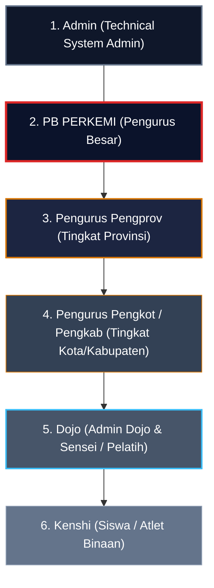

# Spesifikasi Hierarki Peran (Role), Hak Akses, & Penyesuaian Ruang Lingkup Sistem e-Dojo PERKEMI

> **Dasar Kebijakan**: AD/ART PERKEMI, SK PB PERKEMI No. 045/SK-PB/VII/2025, dan Prinsip Tata Kelola Organisasi Shorinji Kempo Indonesia.  
> **Arsitektur Teknis**: Spatie Laravel Permission, Scoped Multi-Tenancy (PB, Pengprov, Pengkot, Dojo), Thin Controllers & Dedicated Action Classes.

---

## 1. Matriks 6 Entitas Akun & Tanggung Jawab

Sistem e-Dojo PERKEMI membagi pengguna ke dalam 6 tingkatan entitas akun (*User Roles*) yang saling terhubung secara berjenjang:

### Rincian Profil & Wewenang Entitas:

| No | Tipe Akun | Role Key Spatie | Ruang Lingkup Data (Scope) | Menu Utama | Wewenang Pokok |
|---|---|---|---|---|---|
| **1** | **Admin** | `SuperAdmin` | Global (Seluruh Sistem & Infrastruktur) | `/dashboard`, `/system/*` | Pemeliharaan server, manajemen role/permission, audit log sistem, backup database. |
| **2** | **PB Perkemi** | `PBPerkemiAdmin` / `SuperAdmin` | Nasional (Seluruh Indonesia) | `/dashboard`, `/pb/*`, `/reports` | Otorisasi persetujuan usulan tarif iuran dojo, pemantauan WSKO Fee & pendaftaran, otorisasi UKT Yudansha (Dan), manajemen kurikulum nasional (video/PDF). |
| **3** | **Pengurus Pengprov** | `PengprovAdmin` | Regional Provinsi (cth: Pengprov Jawa Timur) | `/pengprov`, `/reports` | Monitoring dojo & atlet se-provinsi, verifikasi UKT wilayah, monitoring serapan kurikulum, pemantauan alokasi iuran 10% provinsi. |
| **4** | **Pengurus Pengkot** | `PengkabAdmin` | Teritorial Kota/Kabupaten (cth: Pengkot Surabaya) | `/pengkot`, `/reports` | Monitoring dojo & atlet kota, verifikasi status kelayakan kenshi (bebas tunggakan) untuk Kejurda/Porprov, penyelenggaraan UKT Kyukenshi, alokasi iuran 10% kota. |
| **5** | **Dojo** | `Sensei` & `DojoAdmin` | Cabang Dojo Lokal (cth: Dojo Sawahan) | `/dojo`, `/my-dojo`, `/schedules` | Pengajuan tarif iuran dojo, monitoring kas/alokasi (20% dojo + 40% pelatih), upload video latihan & modul dojo, verifikasi absensi & GPS geotag, evaluasi 5 aspek kenshi. |
| **6** | **Kenshi** | `Kenshi` | Personal Data & Anggota Terafiliasi | `/portal/kenshi`, `/dashboard` (atlet) | Mengakses video/PDF materi sesuai sabuk, cek tagihan & riwayat iuran, presensi selfie + GPS, logbook mandiri, daftar ujian UKT, akses KTA Digital resmi. |

---

## 2. Penyesuaian Ruang Lingkup URL & Akses Portal

Berdasarkan struktur portal yang sudah dibangun dan modul baru yang ditambahkan, berikut adalah pembagian endpoint:

### 2.1. Portal Nasional: `/dashboard` & `/pb`
- **Aktor**: PB PERKEMI & Technical Admin.
- **Fitur Khusus**:
  - **Executive Command Center**: Statistik dojo aktif, total kenshi, dan sebaran sabuk nasional.
  - **Pusat Persetujuan Tarif Iuran**: Maker-checker persetujuan usulan tarif di atas Rp50.000 dengan lampiran SK tertulis.
  - **Ledger Alokasi Nasional**: Monitoring penerimaan iuran 20% Kyukenshi, 100% Yudansha, dan WSKO Admission/Membership Fee.
  - **Pusat Kurikulum & Bank Soal UKT**: Otorisasi materi video/PDF resmi PB PERKEMI.

### 2.2. Portal Wilayah Provinsi: `/pengprov`
- **Aktor**: Pengurus Pengprov PERKEMI.
- **Fitur Khusus**:
  - Daftar dojo dan atlet di seluruh kota/kabupaten dalam naungan provinsi.
  - Rekapitulasi alokasi dana iuran 10% Pengprov.
  - Pengelolaan event Gashuku & Ujian Kenaikan Tingkat (UKT) tingkat provinsi.
  - Verifikasi keaktifan atlet untuk seleksi PON, Pra-PON, atau Kejurnas.

### 2.3. Portal Wilayah Kota/Kabupaten: `/pengkot`
- **Aktor**: Pengurus Pengkot / Pengkab PERKEMI.
- **Fitur Khusus**:
  - Direktori dojo resmi di wilayah kota/kabupaten.
  - Rekapitulasi alokasi dana iuran 10% Pengkot/Pengkab.
  - Verifikasi status lunas kenshi sebelum pengesahan mengikuti Kejurda / Porprov / Walikota Cup.
  - Rekomendasi pembukaan cabang dojo baru di bawah yurisdiksi kota.

### 2.4. Portal Cabang Dojo: `/dojo` & `/my-dojo`
- **Aktor**: Admin Dojo & Sensei (Kepala Pelatih Dojo).
- **Fitur Khusus**:
  - **Pengaturan Iuran Dojo (`/dojo/settings/iuran`)**: Form usulan tarif iuran bulanan Kyukenshi (jika mengajukan di atas Rp50.000) dengan status `pending_pb`.
  - **Materi Dojo (`/dojo/materi`)**: Pembagian materi video drill dojo dan kurikulum latihan harian.
  - **Manajemen Jadwal & Geofencing (`/schedules`)**: Penjadwalan latihan multi-batch dengan toleransi radius GPS.
  - **Sensei Analytics (`/my-dojo`)**: Roster kenshi dojo, rasio kehadiran, rekap evaluasi 5 aspek, dan status tunggakan iuran kenshi.

### 2.5. Portal Mandiri Kenshi: `/portal/kenshi`
- **Aktor**: Kenshi / Atlet.
- **Fitur Khusus**:
  - **KTA Digital**: Kartu Tanda Anggota dengan QR code dan security hash (SHA-256).
  - **Modul Materi & Video (`/portal/kenshi/materi`)**: Video materi dan PDF dokumen yang terbuka sesuai tingkatan sabuk kenshi.
  - **Iuran & Pembayaran (`/portal/kenshi/iuran`)**: Riwayat tagihan, metode bayar (BNI/BRI/MyPerkemi), bukti bayar, dan status lunas.
  - **Presensi Selfie & GPS (`/attendance/check-in`)**: Check-in kehadiran dengan kamera snapshot dan radius validation.
  - **UKT Roadmap & Pendaftaran (`/portal/kenshi/ukt`)**: Indikator kesiapan ujian dan pendaftaran UKT.

---

## 3. Matriks Hak Akses (Permissions Table)

| Kemampuan (Ability / Permission) | Admin | PB Perkemi | Pengprov | Pengkot | Dojo / Sensei | Kenshi |
|---|:---:|:---:|:---:|:---:|:---:|:---:|
| **Materi: Lihat Materi Sesuai Sabuk** | ✅ | ✅ | ✅ | ✅ | ✅ | ✅ (Gated) |
| **Materi: Lihat Seluruh Tingkatan Sabuk** | ✅ | ✅ | ✅ | ✅ | ✅ | ❌ |
| **Materi: Upload / Edit Kurikulum Resmi** | ✅ | ✅ | ❌ | ❌ | ❌ | ❌ |
| **Materi: Upload Video Latihan Lokal Dojo** | ✅ | ✅ | ❌ | ❌ | ✅ (Dojo sendiri) | ❌ |
| **Iuran: Cek Tagihan & Riwayat Sendiri** | ✅ | ✅ | ✅ | ✅ | ✅ | ✅ |
| **Iuran: Ajukan Usulan Tarif Tambahan Dojo** | ❌ | ❌ | ❌ | ❌ | ✅ | ❌ |
| **Iuran: Setujui / Tolak Tarif Dojo (PB)** | ✅ | ✅ | ❌ | ❌ | ❌ | ❌ |
| **Iuran: Lihat Alokasi Wilayah Sendiri** | ✅ | ✅ (Nasional) | ✅ (10% Prov) | ✅ (10% Kota) | ✅ (20% Dojo + 40% Pelatih) | ❌ |
| **Iuran: Verifikasi Pembayaran / Rekonsiliasi**| ✅ | ✅ | ❌ | ❌ | ✅ (Dojo) | ❌ |
| **UKT: Cek Persyaratan & Roadmap Sendiri** | ✅ | ✅ | ✅ | ✅ | ✅ | ✅ |
| **UKT: Rekomendasikan Kenshi Ujian (Sensei)** | ❌ | ❌ | ❌ | ❌ | ✅ | ❌ |
| **UKT: Penilaian Dewan Penguji (Scoring)** | ✅ | ✅ (Dan) | ✅ (Dan/Kyu) | ✅ (Kyu) | ✅ (Kyu) | ❌ |
| **UKT: Pengesahan & Penerbitan Sertifikat** | ✅ | ✅ (Dan & Kyu) | ✅ (Kyu) | ❌ | ❌ | ❌ |
| **Presensi: Check-in Kamera & GPS** | ❌ | ❌ | ❌ | ❌ | ✅ | ✅ |
| **Presensi: Override / Approval Izin Sakit** | ✅ | ❌ | ❌ | ❌ | ✅ (Dojo sendiri) | ❌ |

---

## 4. Keamanan & Boundary Kontrol Data (Scoping)

1. **Prinsip Multi-Tenancy Data Scoping**:
   - Pengurus Pengprov hanya diizinkan melihat dojo dan kenshi yang berdomisili di provinsinya (`where('pengprov', $user->region)`).
   - Pengurus Pengkot hanya diizinkan melihat dojo dan kenshi di wilayah kotanya (`where('pengkab', $user->region)`).
   - Sensei / Admin Dojo hanya dapat memanipulasi data kenshi, jadwal latihan, dan iuran di dojonya sendiri (`where('dojo_id', $user->dojo_id)`).
2. **Pemisahan Pengusul dan Penyetujui (*Maker-Checker Rule*)**:
   - Admin Dojo berposisi sebagai **Maker** (mengusulkan tarif di atas Rp50.000).
   - PB PERKEMI berposisi sebagai **Checker & Approver** (menelaah dokumen dasar dan mengesahkan tarif).
   - Tidak boleh ada peran dojo yang dapat meng-approve usulan tarifnya sendiri.
3. **Audit Trail Wajib**:
   - Setiap perubahan status tarif, verifikasi pembayaran, persetujuan UKT, dan perubahan status keaktifan kenshi wajib dicatat ke dalam tabel `activity_log` menggunakan Spatie ActivityLog.
