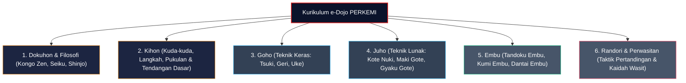
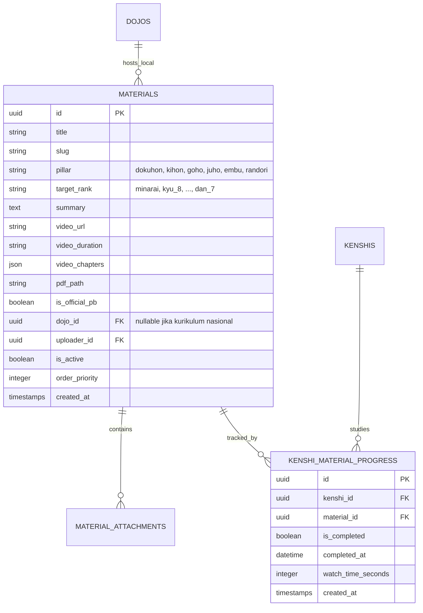

# Spesifikasi Modul Dojo & Manajemen Materi Pembelajaran (Video & PDF)

> **Modul Utama**: `/dojo/materi`, `/portal/kenshi/materi`, dan `/materials`  
> **Tujuan**: Digitalisasi kurikulum resmi Shorinji Kempo PERKEMI melalui streaming video teknik presisi dan modul panduan PDF interaktif dengan sistem pembatasan hak akses (*belt-level gating*).

---

## 1. Taksonomi Kurikulum Shorinji Kempo

Materi pembelajaran dalam e-Dojo PERKEMI dibagi ke dalam 6 pilar utama bela diri Shorinji Kempo:

---

## 2. Struktur Materi Berdasarkan Tingkatan Sabuk (Kenshi Rank)

Kurikulum dikelompokkan secara hierarki berdasarkan tingkatan sabuk resmi PERKEMI:

| Kategori Tingkat | Sabuk / Tingkatan | Warna Sabuk | Fokus Kurikulum Materi |
|---|---|---|---|
| **Mudansha Dasar** | Minarai (Pemula) | Putih | Etika Dojo (*Reigi*), Sejohun, Shinjo, Doshu, Chinkon, Kuda-kuda (*Kamae*), Dasar Tangkisan & Pukulan. |
| **Mudansha Lanjutan I**| Kyu VIII & Kyu VII | Kuning | Ryusui Geri, Uwa Uke Zuki, Kote Nuki dasar, Tandoku Embu Kyu VII, Seiku Dokuhon. |
| **Mudansha Lanjutan II**| Kyu VI & Kyu V | Hijau | Tenshin Geri, Uchi Uke Zuki, Ude Juji Gatame, Maki Gote, Kumi Embu berpasangan dasar. |
| **Mudansha Menengah** | Kyu IV | Biru | Tsurigane Geri, Han Tenshin Geri, Gyaku Gote dasar, Johaku Dori, variasi bantingan. |
| **Mudansha Atas** | Kyu III, II, & I | Coklat | Teknik lanjutan Goho-Juho kombinasi, Renzoku Waza, Kumi Embu Kyu I berpasangan, persiapan ujian I Dan. |
| **Yudansha (Dan)** | I Dan s/d VII Dan | Hitam | Kaidah kepelatihan (*Sensei/Shidoin*), Falsafah Kongo Zen mendalam, teknik rahasia (*Okuden*), Perwasitan (*Shushin/Fukushin*). |

---

## 3. Sistem Pembatasan Akses (*Belt-Level Gating*)

Untuk menjaga kesakralan dan keselamatan latihan teknik bela diri, sistem menerapkan aturan pembatasan akses ketat:

> [!IMPORTANT]
> **Aturan Akses Kenshi**:
> 1. Kenshi hanya diizinkan membuka materi video dan PDF yang **setara dengan tingkatannya saat ini** atau **tingkatan di bawahnya** ($Rank_{materi} \le Rank_{kenshi}$).
> 2. Materi di atas tingkatan kenshi diberi status **TERKUNCI (LOCKED)** dengan indikator gembok visual dan prasyarat kelulusan ujian untuk membukanya.
> 3. Pengecualian berlaku untuk materi berkategori `is_public: true` (seperti etika dojo, doa pembuka, dan sejarah PERKEMI).
> 4. **Sensei, Pengurus, dan PB PERKEMI** memiliki akses penuh (*Unrestricted Access*) ke seluruh repositori materi untuk keperluan pengajaran dan supervisi.

---

## 4. Fitur Interaktif Video & PDF Viewer

### 4.1. Media Player Video Interaktif
- **Format Media**: MP4/WebM streaming teroptimasi atau integrasi embed terproteksi (YouTube Unlisted / Cloudflare Stream).
- **Interactive Drill Timestamps**: Setiap video dilengkapi daftar penanda waktu (*chapter timestamps*) untuk memudahkan kenshi melompat ke bagian teknik spesifik (contoh: *00:45 Posisi Tangan*, *01:30 Gerakan Kaki/Ashi Sabaki*, *02:15 Kunci Akhir/Katame*).
- **Slow-Motion Playback**: Dukungan kontrol kecepatan video ($0.25\times$, $0.5\times$, $0.75\times$, $1\times$) agar atlet dapat mempelajari detail sudut pergerakan sendi secara akurat.

### 4.2. In-Browser PDF Document Viewer
- **Tampilan Terintegrasi**: Membaca buku pedoman ujian (*Kamoku*), lembar penilaian, dan diktat Dokuhon langsung di dalam aplikasi tanpa perlu mengunduh file mentah.
- **Watermark Keamanan Dinamis**: PDF viewer menampilkan watermark nama kenshi dan NIK secara samar di latar belakang untuk mencegah pembajakan atau penyebaran materi berhak cipta tanpa izin.
- **Mode Layar Penuh & Zoom**: Memudahkan pembacaan diagram anatomi titik pukulan (*Kyusho*) dan arah putaran kuncian.

### 4.3. Tracking Kemajuan Belajar (*Learning Progress Tracker*)
- Tombol **"Tandai Selesai Dipelajari" (Mark as Completed)** pada setiap modul materi.
- Persentase serapan materi kurikulum kenshi dihitung secara otomatis:
  $$\text{Progress Rate (\%)} = \left(\frac{\sum \text{Materi Selesai}}{\text{Total Materi pada Sabuk Tersebut}}\right) \times 100\%$$
- **Prasyarat Ujian UKT**: Kenshi diwajibkan mencapai minimal progres $100\%$ materi kurikulum sabuknya sebelum tombol pendaftaran Ujian Kenaikan Tingkat (UKT) dapat diaktifkan.

---

## 5. Modul Materi di Tingkat Cabang Dojo (`/dojo/materi`)

Selain kurikulum nasional terpusat dari PB PERKEMI, portal Dojo (`/dojo`) menyediakan ruang bagi Sensei Dojo untuk:
1. **Mengunggah Video Latihan Khusus Dojo**: Rekaman latihan sesi malam, evaluasi dojo, koreksi Embu pasangan atlet dojo.
2. **Diktat Khusus Dojo**: Jadwal rotasi materi mingguan dojo (*Weekly Drill Agenda*).
3. **Monitoring Serapan Atlet Dojo**: Sensei dapat melihat kenshi mana yang belum menonton materi panduan menjelang jadwal evaluasi mingguan.

---

## 6. Desain Skema Database Modul Materi

---

## 7. Rute & Controller yang Dicanangkan

| Method | Endpoint URI | Controller & Action | Hak Akses (Middleware) |
|---|---|---|---|
| `GET` | `/materials` | `MaterialController@index` | `auth` (Daftar seluruh kurikulum berdasar sabuk) |
| `GET` | `/materials/{material:slug}` | `MaterialController@show` | `auth` (Halaman detail video/PDF viewer) |
| `POST`| `/materials/{material}/toggle-complete` | `MaterialController@toggleComplete` | `role:Kenshi` (Update status selesai) |
| `GET` | `/dojo/materi` | `DojoMaterialController@index` | `role:Sensei,DojoAdmin` (Kelola materi dojo) |
| `POST`| `/dojo/materi` | `DojoMaterialController@store` | `role:Sensei,DojoAdmin` (Upload video/modul dojo) |
| `GET` | `/portal/kenshi/materi` | `KenshiMaterialPortalController@index` | `role:Kenshi` (Tampilan kurikulum personal) |
