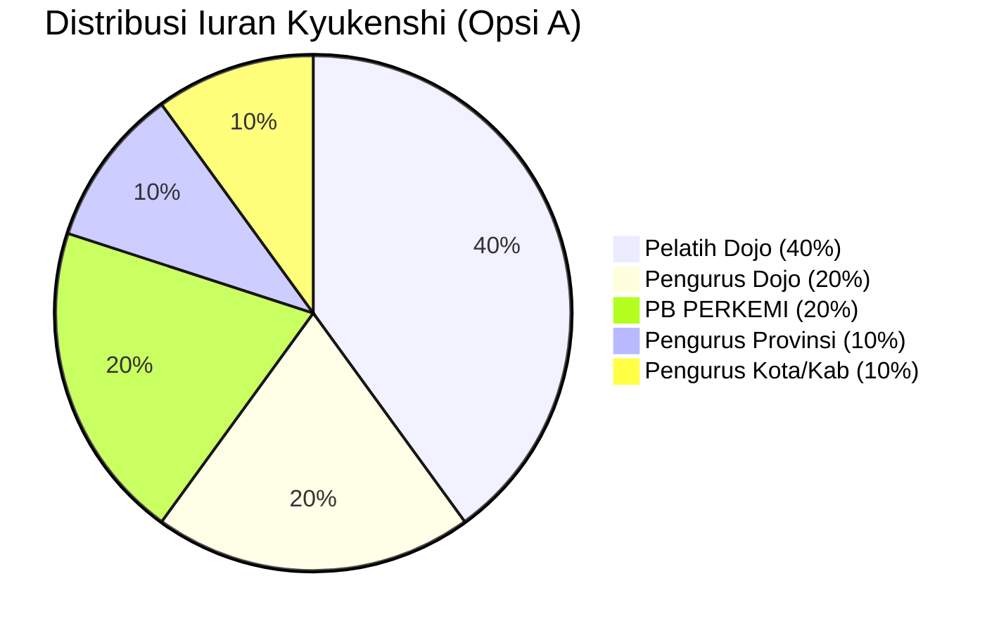
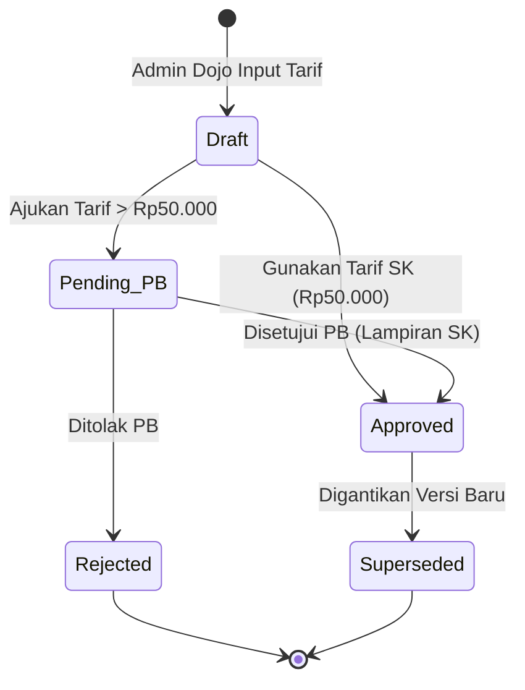
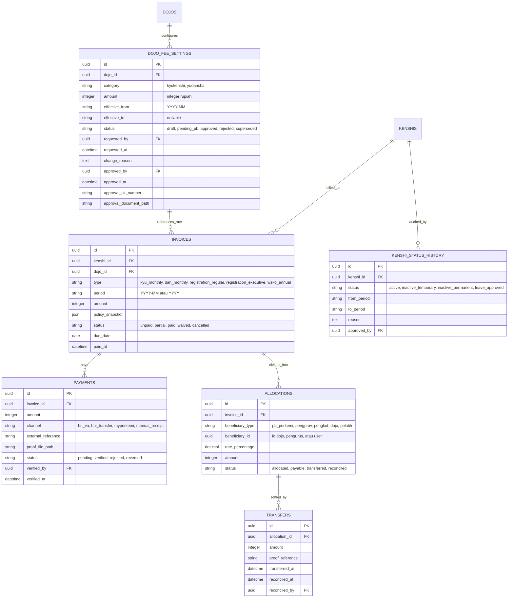

# Spesifikasi Sistem Iuran PERKEMI — Modul /dojo & Portal Keuangan

> **Status Dokumen**: Spesifikasi Kebutuhan Sistem & Desain Arsitektur Finansial  
> **Rujukan Resmi**: 
> 1. SK PB PERKEMI No. 045/SK-PB/VII/2025, ditetapkan 8 Juli 2025  
> 2. Surat Pengantar No. 135/PB-KU/VII/2025 tanggal 14 Juli 2025  
> **Keputusan Desain**: **Opsi A** — Untuk iuran bulanan Kyukenshi, seluruh nominal yang berlaku di dojo dibagikan menurut persentase SK (20% PB / 10% Pengprov / 10% Pengkot / 20% Dojo / 40% Pelatih).  
> **Catatan Otoritas**: Penerapan distribusi atas nominal di atas Rp50.000 adalah usulan dan **wajib mendapatkan persetujuan tertulis PB PERKEMI** sebelum diaktifkan.

---

## 1. Tujuan & Ruang Lingkup Sistem Iuran

Modul `/dojo` mengelola konfigurasi iuran per dojo, pembuatan tagihan (*invoicing*), pencatatan pembayaran, perhitungan hak alokasi, pencatatan realisasi penyaluran (*transfer & reconciliation*), monitoring tunggakan, dan penegakan status keaktifan kenshi.

> [!CAUTION]
> **Prinsip Dasar Finansial**:
> Perhitungan alokasi (status `allocated`) **BUKAN** bukti bahwa dana telah diterima atau ditransfer ke rekening penerima (status `transferred` / `reconciled`). Sistem tidak boleh menyamakan hak alokasi dengan dana fisik yang sudah masuk.

### Diferensiasi 4 Jenis Kewajiban Keuangan:
Sistem memisahkan logika dan aturan untuk 4 jenis kewajiban berikut:
1. **Uang Pendaftaran Anggota Baru** (Reguler & Eksekutif).
2. **Iuran Bulanan Kyukenshi** (Mudansha: Minarai s/d Kyu 1).
3. **Iuran Bulanan Yudansha** (Semua tingkat Sabuk Hitam: I Dan s/d VII Dan).
4. **Membership Fee WSKO** (Iuran tahunan federasi dunia).

*Aturan distribusi bulanan Kyukenshi dilarang keras diterapkan secara otomatis untuk ketiga jenis pembayaran lainnya.*

---

## 2. Ketentuan Resmi Berdasarkan SK PB PERKEMI

| Jenis Kewajiban | Nominal SK | Penerima / Alokasi Dana | Sifat Pembagian | Keterangan & Batas Jatuh Tempo |
|---|---|---|---|---|
| **Pendaftaran Baru — Dojo Reguler** | **Rp60.000** (sekali) | PB PERKEMI: Rp50.000 Admission Fee WSKO: Rp10.000 | **100% PB PERKEMI** | Seluruh setoran disetor ke PB PERKEMI. Tidak dibagi persentase. |
| **Pendaftaran Baru — Dojo Eksekutif** | **Rp160.000** (sekali) | PB PERKEMI: Rp150.000 Admission Fee WSKO: Rp10.000 | **100% PB PERKEMI** | Seluruh setoran disetor ke PB PERKEMI. Tidak dibagi persentase. |
| **Iuran Bulanan Kyukenshi** | **Rp50.000** / bulan | Distribusi 5 Pihak (20/10/10/20/40) | **5 Pihak Terbagi** | Nominal standar SK. Nominal di atas ini wajib persetujuan PB. |
| **Iuran Bulanan Yudansha** | **Rp50.000** / bulan | PB PERKEMI: 100% | **100% PB PERKEMI** | Semua tingkatan Dan (Hitam). Tidak menggunakan distribusi 5 pihak. |
| **Membership Fee WSKO** | **Rp10.000** / tahun | Disetor ke PB PERKEMI | **100% WSKO via PB** | Wajib disetor paling lambat **31 Maret** setiap tahun berjalan. |

*Nomor rekening resmi (BNI untuk pendaftaran/WSKO dan BRI/MyPerkemi untuk iuran) harus diambil secara dinamis dari database konfigurasi resmi pengurus, dilarang ditanam permanen (hardcoded) dalam kode aplikasi.*

---

## 3. Rumus & Distribusi Bulanan Kyukenshi (Opsi A)

Distribusi 5 pihak diterapkan untuk iuran bulanan kenshi tingkat Kyu (Mudansha):

### Simulasi Angka Nominal:

| Penerima Hak Alokasi | Persentase | Standar SK (Rp50.000) | Opsi A Usulan (Contoh Rp100.000)* |
|---|:---:|:---:|:---:|
| **PB PERKEMI** | **20%** | Rp10.000 | Rp20.000 |
| **Pengurus Provinsi (Pengprov)** | **10%** | Rp5.000 | Rp10.000 |
| **Pengurus Kota/Kabupaten (Pengkot)** | **10%** | Rp5.000 | Rp10.000 |
| **Pengurus Dojo** | **20%** | Rp10.000 | Rp20.000 |
| **Pelatih Dojo** | **40%** | Rp20.000 | Rp40.000 |
| **TOTAL** | **100%** | **Rp50.000** | **Rp100.000** |

*\*Catatan: Nominal Rp100.000 hanya berlaku jika telah ada persetujuan tertulis resmi dari PB PERKEMI.*

### Rumus Matematis & Pembulatan Deterministik:
Semua nominal uang disimpan sebagai **integer rupiah**. Jika nominal menghasilkan pecahan rupiah, sistem menggunakan algoritma pembulatan deterministik:
1. Hitung bagian bulat (*floor*) dari setiap porsi penerima.
2. Hitung selisih sisa pecahan rupiah ($Sisa = Nominal - \sum BagianBulat$).
3. Distribusikan sisa rupiah sebanyak 1 rupiah secara berurutan menurut urutan prioritas tetap:  
   $$\text{PB PERKEMI} \longrightarrow \text{Pengprov} \longrightarrow \text{Pengkot} \longrightarrow \text{Dojo} \longrightarrow \text{Pelatih}$$
4. Menjamin jumlah total alokasi **selalu persis sama** dengan nilai transaksi pembayaran tanpa selisih 1 rupiah pun.

---

## 4. Konfigurasi Tarif Per Dojo (`/dojo/settings/iuran`)

Menu pengelolaan tarif dojo dirancang dengan pola **Maker-Checker**:

### Aturan Validasi Tarif Dojo:
1. **Batas Bawah**: Default tarif Kyukenshi adalah Rp50.000. Dilarang mengaktifkan nominal di bawah Rp50.000.
2. **Persetujuan PB Wajib**: Setiap nominal usulan di atas Rp50.000 berstatus `pending_pb`. Selama belum disetujui, tagihan yang diterbitkan tetap menggunakan tarif resmi Rp50.000 (atau versi approved terakhir).
3. **No Overlapping Period**: Hanya boleh ada **satu** konfigurasi tarif approved yang aktif untuk satu dojo pada periode kalender tertentu (`effective_from` s/d `effective_to`).
4. **Immutability Tarif Historis**: Perubahan tarif baru tidak boleh mengubah tagihan dan alokasi periode lama yang telah diterbitkan (*versioned snapshot*).

---

## 5. Alur Pembuatan Tagihan, Pembayaran, & Ledger Alokasi

### 5.1. Pembuatan Tagihan Bulanan Otomatis
- Dijalankan setiap awal bulan (atau saat pendaftaran anggota baru).
- Mengambil kategori kenshi pada periode tersebut:
  - Jika **Kenshi Kyu**: Ambil tarif dojo yang approved dan berlaku.
  - Jika **Kenshi Dan (Yudansha)**: Terapkan tagihan Rp50.000/bulan (100% alokasi PB).
- Menghasilkan snapshot data: `amount`, `category`, `period`, `rate_version_id`, dan `distribution_rules_json` agar kebal terhadap perubahan tarif masa depan.
- **Idempotency Key**: Mencegah tagihan ganda untuk kombinasi `kenshi_id` + `type` + `period`.

### 5.2. Verifikasi Pembayaran & Pencatatan Alokasi
- Status pembayaran: `pending` $\rightarrow$ `verified` / `rejected` / `reversed`.
- Setelah pembayaran berstatus `verified`, sistem membuat entri **Ledger Alokasi**:
  - Untuk Kyukenshi: Membuat 5 record alokasi (PB, Pengprov, Pengkot, Dojo, Pelatih).
  - Untuk Yudansha/Pendaftaran/WSKO: Membuat record alokasi tunggal ke PB dengan rincian peruntukan.
- Setiap entri alokasi membawa status:
  - `allocated`: Hak alokasi telah tercatat dalam sistem.
  - `payable`: Siap dicairkan/disalurkan.
  - `transferred`: Dana telah dikirim ke rekening penerima (disertai nomor referensi mutasi).
  - `reconciled`: Bukti transfer telah dicocokkan dengan rekening koran resmi.

---

## 6. Sanksi Tunggakan & Status Keaktifan Kenshi (Diktum IV–VI SK)

> [!WARNING]
> **Aturan Keaktifan & Hak Kegiatan**:
> 1. **Prasyarat Mutlak Lunas Iuran**: Kenshi **wajib lunas iuran** untuk:
>    - Mengikuti Ujian Kenaikan Tingkat (sebagai peserta maupun penguji).
>    - Mengikuti Penataran Pelatih, Penguji, atau Wasit.
>    - Mengikuti Pertandingan Kejuaraan (sebagai atlet maupun wasit).
>    - Memenuhi syarat verifikasi untuk menjabat sebagai pengurus organisasi di semua tingkatan.
> 2. **Sanksi Menunggak 12 Bulan Berturut-Turut**:
>    - Sistem otomatis mengubah status keanggotaan kenshi menjadi **`inactive_temporary` (Tidak Aktif Sementara)**.
>    - Selama masa tidak aktif sementara, **masa waktu dalam tingkatan sabuknya tidak dihitung**.
> 3. **Cuti / Izin Tidak Aktif Sementara Resmi**:
>    - Kenshi yang mendapat izin resmi tertulis (karena studi/tugas ke luar negeri/sakit berkepanjangan) **dibebaskan dari tagihan iuran bulanan** selama periode izin yang disetujui. Masa waktu tingkatannya tetap dibekukan (*paused*).
> 4. **Pengaktifan Kembali (Reaktivasi)**:
>    - Memerlukan permohonan resmi dan penyelesaian seluruh kewajiban tunggakan yang sah.

---

## 7. Desain Skema Database Finansial (Minimal Data Model)

---

## 8. Kriteria Penerimaan Sistem (Acceptance Criteria Matrix)

| ID | Skenario Pengujian | Hasil yang Wajib Terjadi (Expected Result) |
|---|---|---|
| **AC-01** | Kyukenshi Dojo A tarif resmi SK Rp50.000 lunas. | Alokasi: PB Rp10.000 (20%), Prov Rp5.000 (10%), Kota Rp5.000 (10%), Dojo Rp10.000 (20%), Pelatih Rp20.000 (40%). |
| **AC-02** | Admin Dojo A mengajukan tarif Rp100.000 tanpa approval PB. | Pengajuan berstatus `pending_pb`. Tagihan baru yang terbit tetap menggunakan Rp50.000. |
| **AC-03** | PB menyetujui usulan tarif Rp100.000 dan Opsi A mulai Oktober 2026. | Tagihan baru mulai periode Oktober 2026 bernilai Rp100.000 dengan alokasi Rp20.000 / Rp10.000 / Rp10.000 / Rp20.000 / Rp40.000. |
| **AC-04** | Dojo B tetap menggunakan tarif Rp50.000. | Perubahan tarif Dojo A sama sekali tidak mempengaruhi nominal tagihan Dojo B. |
| **AC-05** | Yudansha membayar iuran Rp50.000. | Alokasi tunggal 100% ke PB PERKEMI Rp50.000 (tidak dibagi 5 pihak). |
| **AC-06** | Pendaftaran anggota baru Dojo Reguler Rp60.000. | Setoran ke PB Rp60.000 (rincian PB Rp50.000 + WSKO Admission Rp10.000). |
| **AC-07** | Pendaftaran anggota baru Dojo Eksekutif Rp160.000. | Setoran ke PB Rp160.000 (rincian PB Rp150.000 + WSKO Admission Rp10.000). |
| **AC-08** | Tagihan Membership Fee WSKO tahunan. | Tagihan terbit Rp10.000/tahun dengan batas penyetoran 31 Maret tahun berjalan. |
| **AC-09** | Pembayaran verified diproses ulang (double webhook). | Idempotency guard aktif: tidak ada duplikasi alokasi, saldo, maupun status. |
| **AC-10** | Konfigurasi tarif dojo diubah setelah periode lama terbayar. | Tagihan dan alokasi historis tidak berubah nilainya (kebal perubahan). |
| **AC-11** | Kenshi menunggak iuran 12 bulan berturut-turut. | Status otomatis berubah menjadi `inactive_temporary`. Tombol pendaftaran UKT, kejuaraan, dan penataran langsung terkunci. |
| **AC-12** | Kenshi memiliki persetujuan cuti / non-aktif sementara dari PB. | Sistem meniadakan tagihan bulanan pada periode cuti yang disetujui, dan masa waktu tingkatan dibekukan. |
| **AC-13** | Alokasi dihitung tetapi transfer belum disalurkan. | Dashboard & laporan keuangan menampilkan status `allocated` / `belum disalurkan`, bukan `sudah masuk ke rekening`. |
