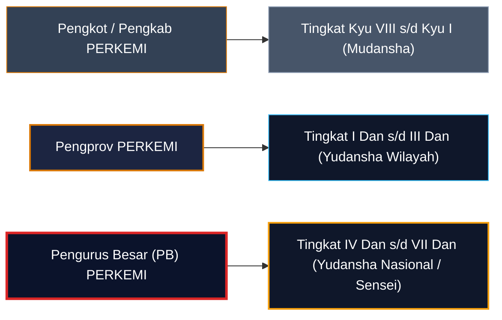
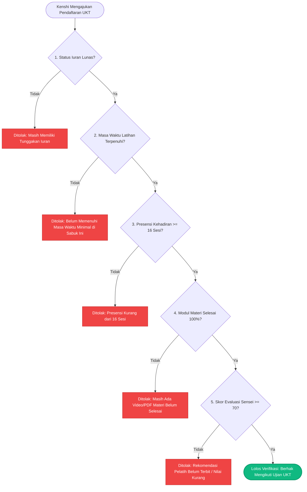
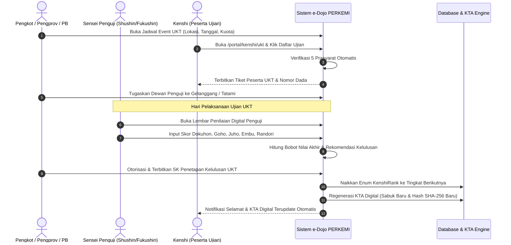

# Spesifikasi Modul Ujian Kenaikan Tingkat (UKT) Shorinji Kempo

> **Modul Terkait**: `/promotions`, `/portal/kenshi/ukt`, dan `/examinations`  
> **Dasar Peraturan**: Peraturan Ujian Kenaikan Tingkat (UKT) PB PERKEMI & Standar Silabus WSKO (*World Shorinji Kempo Organization*).

---

## 1. Filosofi & Jenjang Penyelenggaraan UKT

Ujian Kenaikan Tingkat (UKT) bukan sekadar pengujian kemampuan fisik, melainkan evaluasi terpadu atas penguasaan falsafah (*Dokuhon*), kedisiplinan (*Reigi*), ketahanan fisik, serta kemahiran teknik (*Goho* & *Juho*).

### Yurisdiksi Penyelenggara UKT Berdasarkan Tingkatan Sabuk:

---

## 2. Pintu Gerbang Kelayakan Otomatis (*Automated Gatekeeper*)

Sebelum seorang kenshi dapat mendaftar atau didaftarkan ke sesi UKT, sistem e-Dojo secara otomatis memvalidasi 5 prasyarat wajib (*Strict Eligibility Criteria*):

### Rincian 5 Prasyarat:
1. **Bebas Tunggakan Iuran**: Wajib lunas iuran bulanan dan Membership Fee WSKO tahunan tanpa ada invoice berstatus `unpaid`. Sesuai diktum Keempat SK PB No. 045/SK-PB/VII/2025.
2. **Masa Waktu Latihan (*Time-in-Grade*)**:
   - Minarai $\rightarrow$ Kyu VIII–VII: Minimal 3 bulan latihan rutin.
   - Kyu VI–IV: Minimal 4–6 bulan latihan rutin.
   - Kyu III–I: Minimal 6 bulan latihan rutin per tingkatan.
   - Kyu I $\rightarrow$ I Dan: Minimal 1 tahun latihan intensif.
3. **Presensi Kehadiran Latihan Dojo**: Minimal 16 kehadiran berstatus `present` atau `late` yang tercatat melalui presensi kamera snapshot & GPS geotagging.
4. **Kelulusan Kurikulum Digital**: Kenshi telah menandai selesai seluruh video teknik dan dokumen PDF silabus (*Kamoku*) pada tingkatan sabuknya saat ini di modul `/portal/kenshi/materi`.
5. **Rekomendasi Pelatih Dojo**: Rata-rata evaluasi 5 aspek dari Sensei Dojo $\ge 70$ (Grade B / B+ / A) pada modul `/performance/evaluations`.

---

## 3. Alur Operasional Penyelenggaraan Event UKT

---

## 4. Format Lembar Penilaian Digital (*Digital Scoring Sheet*)

Dewan Penguji (*Shushin* dan *Fukushin*) menggunakan antarmuka tablet/laptop di tepi matras ujian untuk menginput nilai pada 5 parameter:

| Aspek Penilaian | Bobot | Sub-Komponen yang Dinilai | Skor Minimum Lulus |
|---|:---:|---|:---:|
| **1. Dokuhon & Filosofi** | 15% | Hafalan Seiku, Shinjo, Sejohun, Pemahaman Filosofi Kasih Sayang & Kekuatan (*Riki Ai Funi*). | $\ge 70$ |
| **2. Goho (Teknik Keras)** | 25% | Kerapian Tsuki (Pukulan), Akurasi Geri (Tendangan), Ketepatan Uke (Tangkisan), Tenaga Kime & Kiai. | $\ge 70$ |
| **3. Juho (Teknik Lunak)** | 25% | Titik Kunci (*Kyusho*), Efisiensi Tenaga, Kote Nuki, Maki Gote, Gyaku Gote, Kuncian Lantai (*Katame*). | $\ge 70$ |
| **4. Embu (Kerapian Gerak)** | 20% | Kuda-kuda (*Kamae*), Keseimbangan, Keserasian Pasangan (*Choushi*), Irama (*Maai*). | $\ge 70$ |
| **5. Randori & Ketahanan Fisik** | 15% | Kebugaran fisik, kelincahan, sportivitas, etika bertanding (*Reigi*). | $\ge 65$ |

**Perhitungan Nilai Akhir**:
$$\text{Total Skor Akhir} = (0.15 \times \text{Dokuhon}) + (0.25 \times \text{Goho}) + (0.25 \times \text{Juho}) + (0.20 \times \text{Embu}) + (0.15 \times \text{Randori})$$

### Kategori Hasil Ujian:
- $\ge 85$: **Lulus Sangat Memuaskan (*Honorable Pass*)**
- $70 - 84$: **Lulus Standar (*Pass*)**
- $60 - 69$: **Ujian Ulang (*Remedial Technical Session*)** dalam rentang waktu 30 hari.
- $< 60$: **Belum Lulus (*Failed*)**, wajib mengulang persiapan 1 siklus periode berikutnya.

---

## 5. Pengesahan & Pembaruan KTA Digital

Setelah SK kelulusan ditandatangani oleh PB PERKEMI atau Pengprov/Pengkot yang berwenang:
1. Kolom `rank` pada tabel `kenshis` otomatis diperbarui ke tingkatan berikutnya (`KenshiRank::nextRank()`).
2. Riwayat promosi dicatat dalam tabel `kenshi_promotions` (menyimpan tanggal ujian, nomor SK, nama penguji, dan nilai akhir).
3. Halaman KTA Digital Kenshi (`/portal/kenshi`) seketika memperbarui:
   - Warna lis sabuk digital (Putih $\rightarrow$ Kuning $\rightarrow$ Hijau $\rightarrow$ Biru $\rightarrow$ Coklat $\rightarrow$ Hitam).
   - Label tingkatan resmi (contoh: *Kyu I* menjadi *I Dan Yudansha*).
   - Hash pengaman anti-pemalsuan (SHA-256) diperbarui berdasarkan tingkatan baru.
4. Akses modul video dan PDF kurikulum kenshi otomatis membuka materi tingkatan baru yang sebelumnya terkunci.
