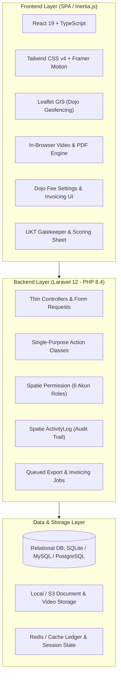
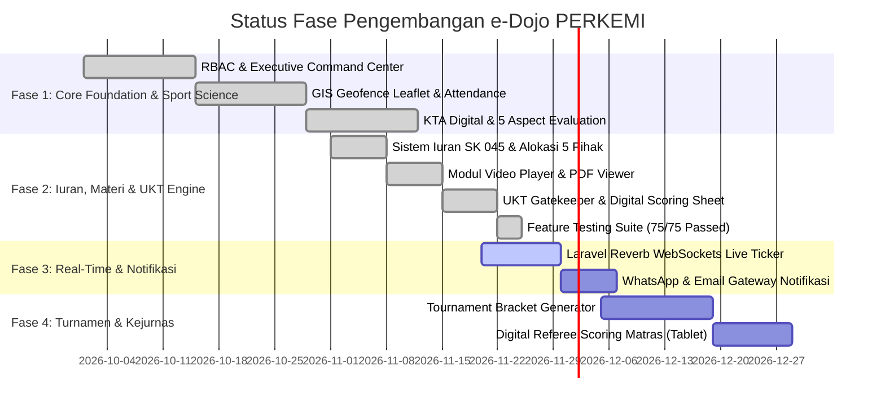

# Master Blueprint & Technical Planning: e-Dojo PERKEMI

> **Aplikasi**: e-Dojo PERKEMI (Persaudaraan Bela Diri Kempo Indonesia)  
> **Status Sistem**: Versi 2.1 Live Implementation & Verification (75 Feature & Unit Tests Passed - 100%)  
> **Rujukan Utama**: SK PB PERKEMI No. 045/SK-PB/VII/2025, Silabus WSKO, & Konvensi Arsitektur Laravel 12 + Inertia React 19.

---

## 1. Indeks Dokumen Spesifikasi Sistem (.md)

Dokumentasi lengkap e-Dojo PERKEMI telah dibagi ke dalam berkas-berkas spesifikasi modular untuk masing-masing bidang:

| Modul Dokumen | Lokasi Berkas | Deskripsi & Ruang Lingkup | Status Implementasi |
|---|---|---|:---:|
| **Hierarki Peran & Akses** | [docs/HIERARKI_ROLE_DAN_AKSES.md](file:///Users/macbookair/Documents/website/perkemi/e-dojo/docs/HIERARKI_ROLE_DAN_AKSES.md) | Pembagian wewenang 6 entitas akun (Admin, PB Perkemi, Pengprov, Pengkot, Dojo, Kenshi) serta penyesuaian URL `/dojo`, `/pengprov`, `/pengkot`, `/portal/kenshi`. | **SELESAI (LIVE)** |
| **Modul Dojo & Materi (Video & PDF)** | [docs/MODUL_DOJO_DAN_MATERI.md](file:///Users/macbookair/Documents/website/perkemi/e-dojo/docs/MODUL_DOJO_DAN_MATERI.md) | Sistem kurikulum bela diri Shorinji Kempo, streaming video latihan dengan timestamp drill, in-browser PDF Dokuhon/Kamoku, dan gating materi per sabuk. | **SELESAI (LIVE)** |
| **Sistem Iuran PERKEMI** | [docs/MODUL_IURAN_PERKEMI.md](file:///Users/macbookair/Documents/website/perkemi/e-dojo/docs/MODUL_IURAN_PERKEMI.md) | Implementasi SK PB No. 045/SK-PB/VII/2025: Pembagian 5 pihak Kyukenshi (20/10/10/20/40), Yudansha 100% PB, Opsi A usulan tarif >Rp50k dengan approval PB, tagihan, ledger alokasi, pembulatan rupiah deterministik, dan sanksi tunggakan 12 bulan. | **SELESAI (LIVE)** |
| **Ujian Kenaikan Tingkat (UKT)** | [docs/MODUL_UJIAN_KENAIKAN_TINGKAT_UKT.md](file:///Users/macbookair/Documents/website/perkemi/e-dojo/docs/MODUL_UJIAN_KENAIKAN_TINGKAT_UKT.md) | Gerbang verifikasi otomatis kelayakan ujian (bebas tunggakan, presensi $\ge 16$, materi selesai 100%, evaluasi Sensei $\ge 70$), lembar penilaian digital penguji, promosi sabuk, & KTA update. | **SELESAI (LIVE)** |
| **Sistem Desain UI/UX & Master Mockup** | [docs/UI_UX_DESIGN_SYSTEM_AND_PLANNING.md](file:///Users/macbookair/Documents/website/perkemi/e-dojo/docs/UI_UX_DESIGN_SYSTEM_AND_PLANNING.md) | Panduan sistem desain profesional enterprise, token warna (`#102B40`, `#C51C2A`, `#F8F9FA`), tata letak desktop 1440px & mobile 390px, bottom nav, dan navigation drawer. | **SELESAI (LIVE)** |
| **Autentikasi, Login & Loading Screen** | [docs/AUTHENTICATION_AND_LOADING_UI_UX.md](file:///Users/macbookair/Documents/website/perkemi/e-dojo/docs/AUTHENTICATION_AND_LOADING_UI_UX.md) | Desain login enterprise split-screen desktop (40/60) & mobile, ilustrasi garis arsitektur dojo, 4 status loading screen transisi halus, WCAG AA, dan proteksi enumerasi akun. | **SELESAI (LIVE)** |
| **Registrasi Kenshi Baru (Wizard)** | [docs/REGISTRASI_KENSHI_WIZARD_UI_UX.md](file:///Users/macbookair/Documents/website/perkemi/e-dojo/docs/REGISTRASI_KENSHI_WIZARD_UI_UX.md) | Multi-step registration wizard (01 Identitas, 02 Afiliasi Dojo, 03 Akun & Keamanan, 04 Konfirmasi Pendaftaran), stepper vertikal desktop, progress bar mobile, validasi bertahap, dan integrasi backend. | **SELESAI (LIVE)** |

---

## 2. Arsitektur Solusi & Ekosistem Teknologi

---

## 3. Peta Penyesuaian Ruang Lingkup URL Organisasi

Berdasarkan struktur kepengurusan dan arahan integrasi fitur:

### 1. `/dashboard` — Pusat Komando PB PERKEMI & Admin Sistem
- Metrik makro nasional: total dojo terdaftar, jumlah kenshi aktif se-Indonesia, rasio sabuk Yudansha vs Mudansha.
- Panel persetujuan usulan tarif iuran dojo (`pending_pb` $\rightarrow$ `approved`).
- Rekonsiliasi setoran nasional pendaftaran baru, iuran Yudansha 100%, dan WSKO Membership Fee.
- Audit trail aktivitas pengurus dan pergantian status kenshi.

### 2. `/pengprov` — Portal Wilayah Pengurus Provinsi
- Monitoring dojo dan atlet di bawah naungan provinsi.
- Pemantauan alokasi hak iuran 10% tingkat Pengprov.
- Pengelolaan Gashuku Wilayah & UKT Dan I–III tingkat daerah.
- Rekapitulasi serapan kurikulum latihan di dojo-dojo se-provinsi.

### 3. `/pengkot` — Portal Wilayah Pengurus Kota / Kabupaten
- Direktori dojo cabang kota/kabupaten.
- Pemantauan alokasi hak iuran 10% tingkat Pengkot/Pengkab.
- Validasi status bebas tunggakan kenshi sebelum pengesahan atlet untuk Kejurda / Porprov.
- Penyelenggaraan Ujian Kenaikan Tingkat (UKT) Kyukenshi tingkat kota.

### 4. `/dojo` & `/my-dojo` — Portal Cabang Dojo & Pelatih (Sensei)
- **Pengaturan Iuran Dojo (`/dojo/settings/iuran`)**: Input usulan tarif bulanan Kyukenshi dengan status persetujuan PB.
- **Monitoring Alokasi Dojo (`/dojo/iuran`)**: Hak dana pengurus dojo (20%) dan hak dana pelatih dojo (40%).
- **Materi Latihan Dojo (`/dojo/materi`)**: Upload video latihan khusus dojo dan modul drill lokal.
- **Presensi & Jadwal Latihan (`/schedules`)**: Penjadwalan multi-batch dengan toleransi radius geofence.
- **Evaluasi Atlet 5 Aspek (`/performance/evaluations`)**: Penilaian teknik, embu, randori, fisik, dan disiplin kenshi.

### 5. `/portal/kenshi` — Portal Mandiri Kenshi (Siswa / Atlet)
- **KTA Digital Resmi**: Kartu anggota dengan QR code dan security hash (SHA-256).
- **Akses Video & Modul PDF (`/portal/kenshi/materi` & `/materials`)**: Modul kurikulum yang terbuka sesuai tingkatan sabuk kenshi.
- **Tagihan Iuran & Pembayaran (`/portal/kenshi/iuran`)**: Cek invoice, nomor rekening resmi, upload bukti pembayaran, dan status lunas.
- **Presensi Cerdas (`/attendance/check-in`)**: Presensi selfie kamera dan verifikasi jarak radius GPS Haversine.
- **Pendaftaran UKT (`/portal/kenshi/ukt`)**: Indikator kelayakan 5 syarat mutlak dan pendaftaran sesi ujian.

---

## 4. Status Fase Pengembangan (/fase)

### Rincian Capaian Tiap Fase:

#### ✅ Fase 1: Fondasi Organisasi & Sport Science (SELESAI)
- [x] Multi-Role Hierarchy: SuperAdmin (PB), PengprovAdmin, PengkabAdmin, Sensei, Kenshi.
- [x] Dojo GIS Geofencing dengan Leaflet map coordinates & radius.
- [x] Smart Attendance Kamera Snapshot + Geotag GPS (Haversine Formula).
- [x] KTA Digital resmi dengan QR code & SHA-256 cryptographic hash.
- [x] Evaluasi 5 Aspek Pelatih, Logbook Latihan Mandiri, dan Laporan Antrean Ekspor.

#### ✅ Fase 2: Sistem Iuran SK 045, Kurikulum Materi & Ujian UKT (SELESAI & TERUJI)
- [x] **Sistem Iuran PERKEMI (SK No. 045/SK-PB/VII/2025)**:
  - Pembagian 5 pihak Kyukenshi (PB 20%, Prov 10%, Kota 10%, Dojo 20%, Pelatih 40%).
  - 100% Setoran PB untuk Yudansha, Pendaftaran Baru (Reguler/Eksekutif), dan WSKO Fee.
  - Alur persetujuan tarif tambahan per dojo di atas Rp50.000 (`pending_pb` $\rightarrow$ `approved`).
  - Pembulatan rupiah deterministik (PB $\rightarrow$ Prov $\rightarrow$ Kota $\rightarrow$ Dojo $\rightarrow$ Pelatih).
  - Sanksi pembekuan kenshi yang menunggak 12 bulan berturut-turut menjadi `inactive_temporary`.
  - Halaman Pengaturan Tarif Dojo (`/dojo/settings/iuran`), Kas Dojo (`/dojo/iuran`), dan Portal Kenshi (`/portal/kenshi/iuran`).
- [x] **Modul Materi Pembelajaran (Video & PDF)**:
  - Repositori kurikulum Shorinji Kempo (Dokuhon, Kihon, Goho, Juho, Embu, Randori).
  - *Belt-level gating* (Kenshi hanya dapat membuka materi setingkat atau di bawah sabuknya).
  - Video player interaktif dengan *chapter drill timestamps* dan PDF reader resmi.
  - Tracking kemajuan materi kenshi sebagai syarat kelulusan kurikulum.
  - Portal pengunggahan materi khusus cabang dojo (`/dojo/materi`).
- [x] **Modul Ujian Kenaikan Tingkat (UKT)**:
  - Pintu gerbang otomatis 5 prasyarat mutlak (Lunas iuran, presensi $\ge 16$, materi 100%, skor pelatih $\ge 70$, anggota aktif).
  - Lembar penilaian digital dewan penguji (*Shushin/Fukushin*) dengan pembobotan: Dokuhon 15%, Goho 25%, Juho 25%, Embu 20%, Randori 15%.
  - Otorisasi kelulusan dan promosi otomatis tingkatan sabuk kenshi (`KenshiRank::nextRank()`) serta regenerasi data KTA Digital.
- [x] **75 Automated Unit & Feature Tests (100% Passed)** & Vite Production Build Sukses.

#### ⏳ Fase 3: Real-Time & Notifikasi (Roadmap Selanjutnya)
- [ ] Live Attendance Ticker menggunakan Laravel Reverb WebSockets.
- [ ] Integrasi WhatsApp Gateway untuk notifikasi kehadiran dan tagihan iuran bulanan ke atlet/orang tua.

#### ⏳ Fase 4: Turnamen & Penjurian Matras (Roadmap Selanjutnya)
- [ ] Bagan turnamen kejuaraan otomatis (*Single/Double Elimination Bracket*).
- [ ] Antarmuka skoring wasit digital (*Fukushin & Shushin*) via tablet di tepi matras pertandingan Embu dan Randori.
