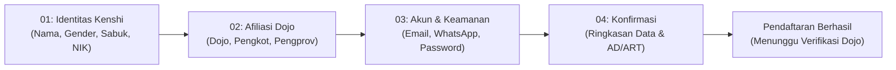

# Dokumentasi Sistem Registrasi Kenshi Baru (Multi-Step Wizard UI/UX) — e-DOJO PERKEMI

> **Aplikasi**: e-DOJO — Sistem Terpadu Manajemen Dojo, Kenshi & KTA Digital  
> **Standar UI/UX**: Clean & Minimalist UI, Premium Enterprise Multi-Step Registration Wizard  
> **Status**: Selesai Diimplementasikan (Live) & Terverifikasi (Desktop 1440 × 900 px & Mobile 390 × 844 px)  
> **Rujukan Desain**: Mockup Presentasi UI/UX Pendaftaran Kenshi (`Desktop • Identitas` & `Mobile • Afiliasi`).

---

## 1. Filosofi & Pendekatan Desain

Proses pendaftaran anggota bela diri Shorinji Kempo melibatkan pengumpulan data yang berlapis: identitas kenshi, penentuan tingkatan sabuk awal, verifikasi afiliasi dojo dan kepengurusan wilayah (Pengkot/Pengprov), serta pembuatan akun akses sistem e-DOJO.

Untuk mencegah *cognitive overload* yang timbul dari satu formulir panjang:
- Formulir dipecah menjadi **Multi-Step Registration Wizard (4 Tahapan Terstruktur)**.
- Mengadopsi prinsip **Clean & Minimalist Enterprise UI**: tanpa ornamen tidak perlu (*no AI slop*), spasi terukur berbasis 8px, dan kontras warna berstandar WCAG AA.
- Mempertahankan integritas seluruh field data yang disyaratkan oleh backend (`AuthController::register()`) tanpa menyederhanakan aturan bisnis organisasi.

---

## 2. Design System & Token Warna

| Elemen Antarmuka | Nilai Hex | Peran & Penggunaan |
|---|---|---|
| **Primary Navy** | `#102B40` | Warna solid panel sisi kiri (desktop stepper) dan tombol navigasi wizard *Lanjutkan*. |
| **Navy Hover** | `#1A3B52` | Status hover tombol utama dan garis penghubung langkah berikutnya. |
| **Navy Active** | `#24475E` | Status klik/active tombol utama. |
| **Perkemi Red** | `#C51C2A` | Warna aksen resmi: logo perisai, indikator langkah aktif (lingkaran stepper), bilah progress bar, dan tombol submit *Kirim Pendaftaran*. |
| **Canvas Background** | `#F8F9FA` | Latar belakang canvas luar aplikasi. |
| **Card Surface** | `#FFFFFF` | Latar belakang panel formulir dan ringkasan data. |
| **Primary Text** | `#17202D` | Warna judul, label input, dan nilai ringkasan data kenshi. |
| **Secondary Text** | `#718092` | Sub-judul keterangan langkah, teks pembantu (*hint*), dan placeholder. |
| **Border Line** | `#E8EBEF` | Garis tepi 1px kartu utama, batas input field, dan garis pembagi footer. |
| **Success Emerald** | `#16865C` | Ikon centang langkah selesai (`Check`), badge status aman. |
| **Error / Alert** | `#DC3545` | Indikator kesalahan validasi dan border field invalid. |

---

## 3. Alur Multi-Step Registration Wizard (4 Langkah)

### Langkah 1 — Identitas Kenshi
- **Nama lengkap Kenshi** (`full_name`): Input teks wajib (Contoh: *Budi Prasetyo*).
- **Jenis kelamin** (`gender`): Select wajib (*Laki-laki / Perempuan*).
- **Tingkatan sabuk awal** (`rank`): Select wajib yang bersumber dinamis dari master data `ranks` Perkemi (dari *Minarai/Kyu 7* hingga tingkatan Yudansha).
- **Nomor Induk Kenshi (NIK Kenshi)** (`id_card_number`): Input opsional. Terdapat teks pembantu: *"Kosongkan jika anggota baru (sistem akan menerbitkan nomor secara otomatis)"*.
- **Callout Asal Dojo**: Kotak info berikon perisai merah yang memberitahukan bahwa data dojo akan dilengkapi pada langkah berikutnya.

### Langkah 2 — Afiliasi Dojo & Organisasi
- **Asal Dojo** (`dojo_id`): Select wajib dari database cabang dojo aktif Perkemi dengan format *Nama Dojo — Wilayah/Kota*.
- **Asal Pengkot / Pengkab** (`pengkot_id`): Select opsional kepengurusan kota/kabupaten. Terdapat badge indikator otomatis `Atlet Pengkot` saat dipilih.
- **Asal Pengprov** (`pengprov_id`): Select opsional kepengurusan provinsi. Terdapat badge indikator otomatis `Atlet Puslatda / Pengprov` saat dipilih.

### Langkah 3 — Kontak & Keamanan Akun
- **Nomor WhatsApp / HP** (`phone`): Input telepon format Indonesia untuk keperluan notifikasi kegiatan dan presensi.
- **Alamat email** (`email`): Input email resmi yang akan digunakan untuk autentikasi login ke e-DOJO.
- **Kata sandi** (`password`): Input minimal 6 karakter dilengkapi tombol pengalih tampil/sembunyi sandi (`Eye` / `EyeOff`).
- **Konfirmasi kata sandi** (`password_confirmation`): Validasi kesesuaian sandi secara *real-time*.

### Langkah 4 — Ringkasan & Konfirmasi Pendaftaran
- **Ringkasan Identitas**: Menampilkan Nama Lengkap, Gender, Tingkatan Sabuk, dan NIK (atau keterangan *Diterbitkan Otomatis*).
- **Ringkasan Afiliasi**: Menampilkan Dojo terpilih, Pengkot/Pengkab, dan Pengprov.
- **Ringkasan Akun**: Menampilkan Email dan No. WhatsApp (kata sandi tidak pernah ditampilkan demi keamanan).
- **Tombol Koreksi Cepat (`Ubah`)**: Setiap seksi ringkasan memiliki tombol `Ubah` yang langsung membawa kenshi kembali ke langkah bersangkutan tanpa menghapus data yang telah diisi.
- **Persetujuan AD/ART**: Checkbox pernyataan kebenaran data dan kesediaan mematuhi Anggaran Dasar / Anggaran Rumah Tangga (AD/ART) PERKEMI.

---

## 4. Tata Letak Desktop vs Mobile

### Desktop Split-Screen (1440 × 900 px)
- **Panel Kiri (30% width)**:
  - Latar belakang solid Dark Navy `#102B40`.
  - Logo perisai merah, teks `e-DOJO`, `PERKEMI INDONESIA`, dan garis aksen merah.
  - **Vertical Stepper**: Lingkaran merah menyala `#C51C2A` untuk langkah aktif, lingkaran hijau bercentang `#16865C` untuk langkah selesai, dan lingkaran abu-abu untuk langkah berikutnya, dihubungkan garis vertikal mulus.
- **Panel Kanan (70% width)**:
  - Latar belakang putih `#FFFFFF`, lebar form maksimal 720 px.
  - Header judul langkah dan horizontal progress bar merah.
  - Tombol navigasi bawah: Tautan *Sudah memiliki akun? Masuk* di kiri, dan tombol *Kembali* serta *Lanjutkan* / *Kirim Pendaftaran* di kanan.

### Mobile View (390 × 844 px)
- **Single-Column Flow**: Panel kiri desktop dihilangkan untuk menghemat ruang pandang ponsel.
- **Mobile Header Ringkas**: Logo perisai e-DOJO dan pill penanda `Langkah X / 4`.
- **Form Area 24 px Padding**: Seluruh input dan tombol aksi memenuhi standar ergonomi sentuh (tinggi 48 px / `h-12`).
- **Touch-Friendly Bottom Bar**: Tombol *Kembali* dan *Lanjutkan* tersemat rapi di bagian bawah form dan tidak terpotong oleh keyboard perangkat.

---

## 5. Form State & Manajemen Validasi

1. **Client-Side Progressive Validation**:
   - Pengguna tidak dapat melangkah ke Step 2 jika Step 1 belum valid (*nama wajib diisi*).
   - Pengguna tidak dapat melangkah ke Step 3 jika belum memilih cabang dojo.
   - Pengguna tidak dapat melangkah ke Step 4 jika format email keliru atau konfirmasi sandi tidak cocok.
2. **Backend Error Auto-Routing**:
   - Jika saat submit backend mengembalikan galat (misal email telah terdaftar), hook `useEffect` secara otomatis mengarahkan wizard kembali ke langkah yang memuat error dan menyorot field bersangkutan.
3. **Mencegah Double-Submission**:
   - Tombol *Kirim Pendaftaran* otomatis beralih menjadi status *disabled* dengan spinner berputar dan label *"Mendaftarkan Kenshi…"*.

---

## 6. Verifikasi & Integritas Kode

- **Pint Style Fixer**: `vendor/bin/pint --format agent` lulus tanpa ada catatan kesalahan gaya kode.
- **Vite Production Bundler**: `bun run build` berhasil mengompilasi chunk `Register-B0bY_lcz.js` dalam 677ms (0 errors).
- **Automated Feature Tests**: `php artisan test --compact` mencatatkan **80/80 tests passed (506 assertions)**.
